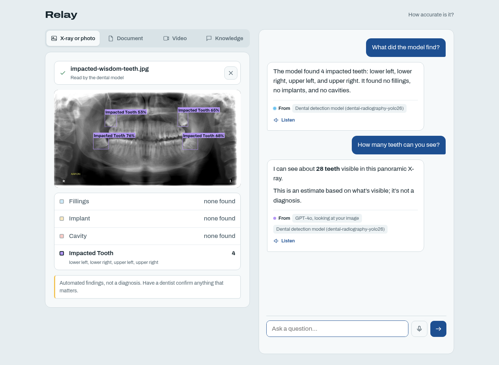

# Relay

A small Flask app for asking questions about dental X-rays, PDFs/Word files, YouTube videos and a built-in
knowledge base, by typing or by voice. Each answer shows where it came from.



## What it does

| Tab | Input | Answers cite |
|---|---|---|
| X-ray or photo | JPG/PNG up to 20 MB | the dental model's findings, or GPT vision |
| Document | PDF, DOCX or TXT up to 50 MB | page, paragraph or line |
| Video | public YouTube link under an hour | timestamp |
| Knowledge | built in (`knowledge.json`) | the entry, or web pages searched |

On X-rays, a pretrained YOLO model ([dental-radiography-yolo26](https://huggingface.co/lukasiktar11/dental-radiography-yolo26))
runs first and draws its findings on the image. If a source can't answer, the question falls back to the next one
(GPT vision, then web search for the knowledge tab, then general GPT knowledge, which is always labelled as such).

## Run it

You need Python 3.12, an OpenAI API key, and ffmpeg (only for videos without captions).

```bash
python3.12 -m venv .venv && source .venv/bin/activate
pip install torch torchvision --index-url https://download.pytorch.org/whl/cpu
pip install -r requirements.txt
cp .env.example .env     # set OPENAI_API_KEY and SECRET_KEY
python app.py
```

Open <http://127.0.0.1:5000/app>. The model weights are in `models/` and are downloaded if missing.
The X-ray tab has three sample images to try.

## Configuration

Set in `.env`:

| Variable | Default | Purpose |
|---|---|---|
| `OPENAI_API_KEY` | none | Required |
| `SECRET_KEY` | random per start | Set it, or loaded sources are lost on restart |
| `CHAT_MODEL` / `VISION_MODEL` | `gpt-5.4-mini` | Models used for answers and images |
| `DENTAL_CONF` | `0.4` | Detection confidence; lower finds more, with more false alarms |
| `PORT` | `5000` | Server port |

More options (rate limits, cookie settings, model path) are in `.env.example`.

## Files

```
app.py        Flask routes, per-tab source store, rate limiting
main.py       text extraction, retrieval, cited answers, fallback chain
dental.py     dental model, X-ray check, annotated image
test_app.py   tests with OpenAI stubbed
report_eval/  evaluation scripts and results
```

## Tests and deployment

```bash
python test_app.py      # OpenAI stubbed, free
python main.py          # self-checks
python dental.py        # self-checks
```

```bash
docker build -t relay . && docker run -p 8000:8000 --env-file .env relay
```

The Dockerfile builds but hasn't been run-tested. It uses one worker because sources and rate limits are kept in memory.

## How well it works

On 194 X-rays from the Kaggle dataset, the detector is reliable for fillings (F1 0.93) and weak for the rest:
cavities 0.56, impacted teeth 0.50, implants 0.39 (it misses most implants). On 20 test questions, 17 had a
supporting citation. That test was small and partly judged by Claude, so treat it as a rough guide.
Details are in `report_eval/`.

## Limitations

- Not a diagnosis. Treat anything other than fillings as a hint.
- Positions (upper/lower, left/right) are approximate.
- Scanned PDFs have no text to read; upload the pages as images.
- No accounts: uploads live in memory, tied to a browser session.
- Everything you upload or ask goes to OpenAI, except the dental model, which runs locally.

## Licenses

The dental model is AGPL-3.0, so offering Relay as a public service may require publishing your source.
Sample X-rays come from Kaggle Dental Radiography (CC BY-SA 4.0) and Wikimedia Commons (CC BY-SA), resized.
Built with Flask, Ultralytics, OpenAI, pypdfium2, python-docx, yt-dlp and youtube-transcript-api.
